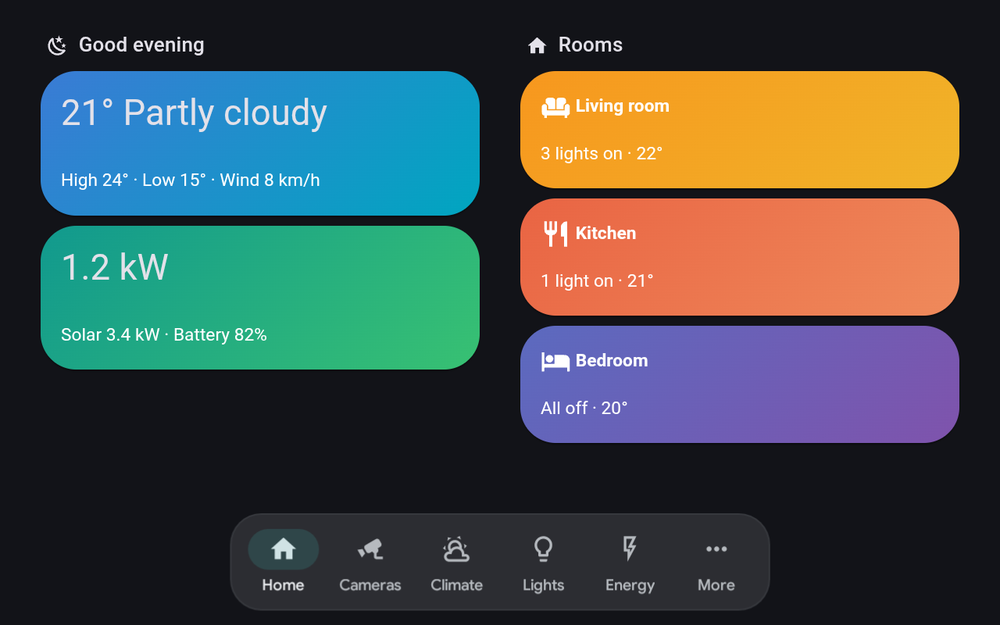
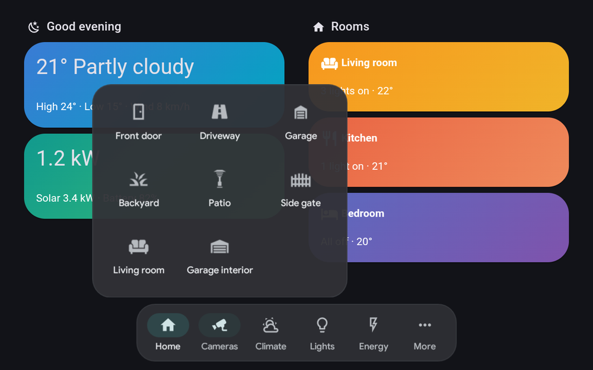
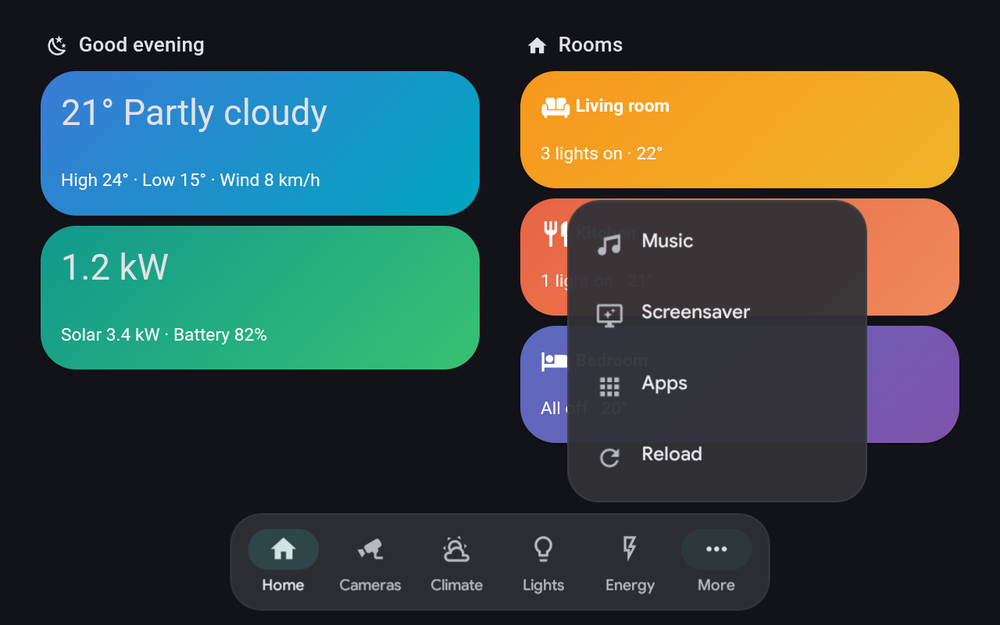
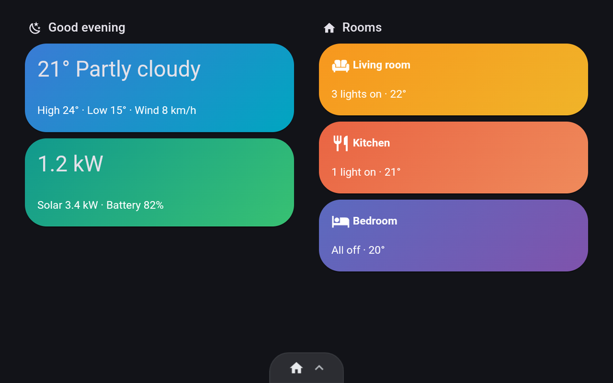
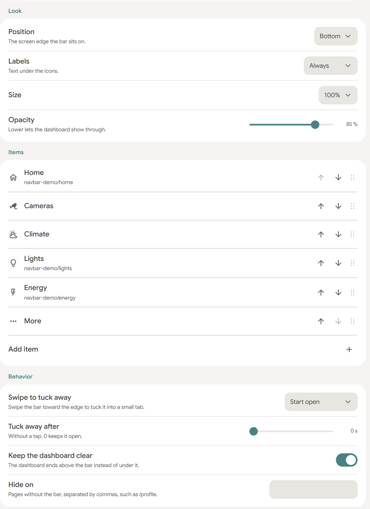
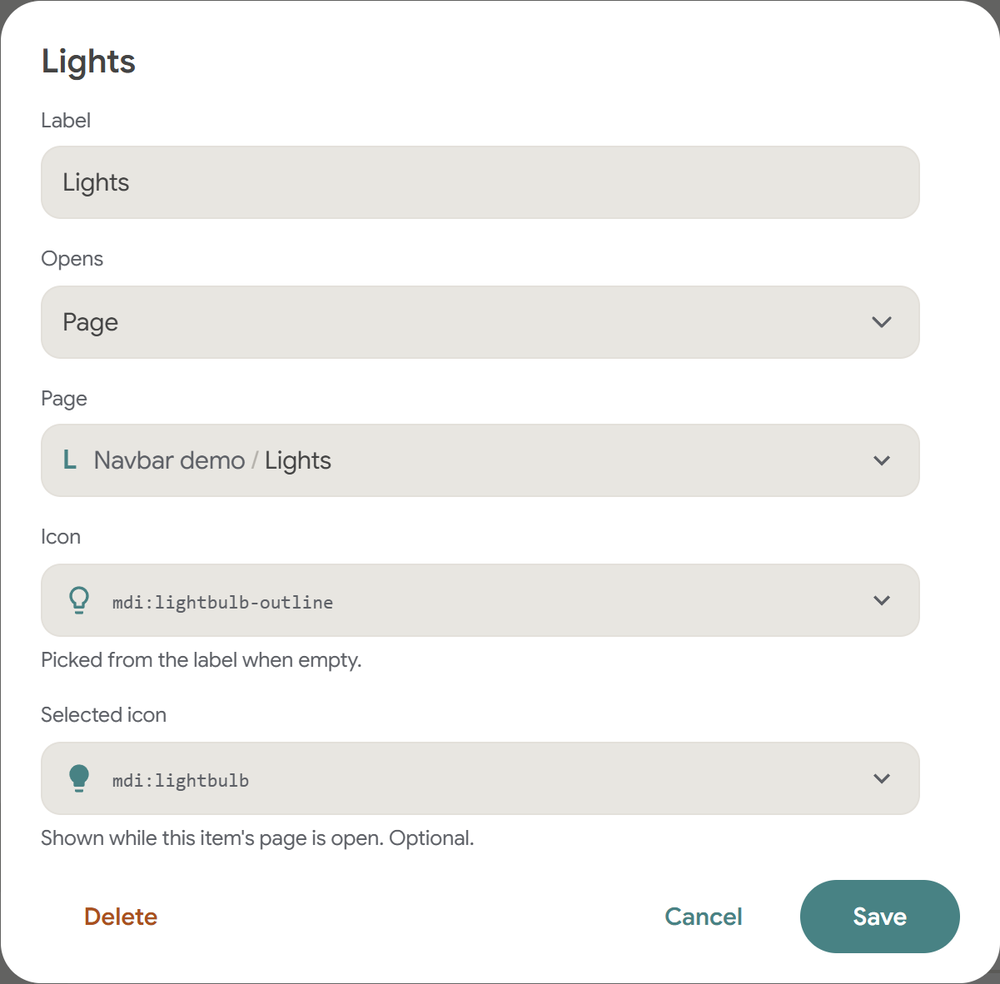
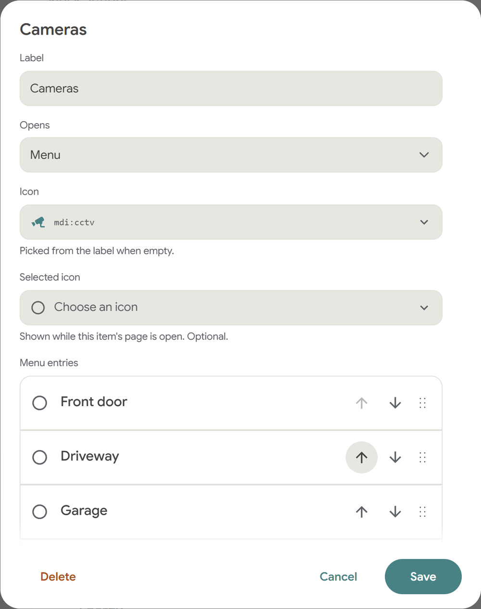
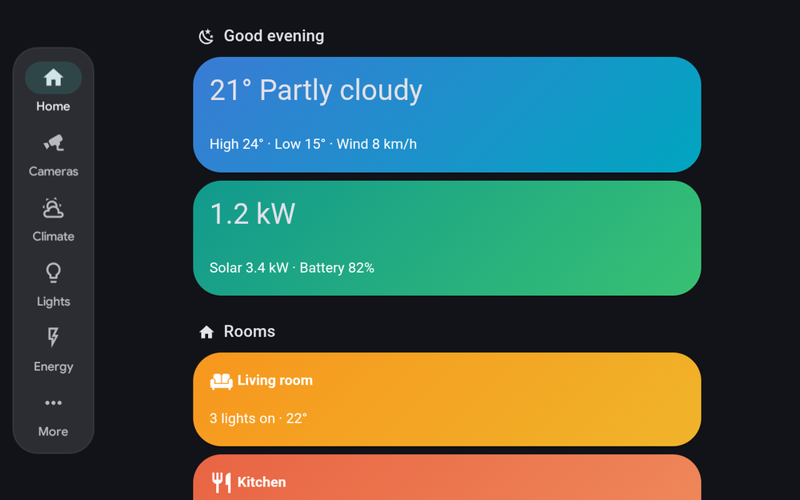

# Navbar for Kiosk Satellite

A native navigation bar for [Kiosk Satellite](https://github.com/jxlarrea/kiosk-satellite) wall panels. KS draws it itself, with its own colors, type and icons, so it looks like part of the kiosk rather than part of the dashboard.

<p align="center"></p>

- **Knows where you are.** The current page's item lights up, however you got there.
- **Menus and grids.** An item can open a list, or a grid of tiles for things like cameras.
- **Kiosk actions.** Open camera views, Music Assistant, Now Playing, the screensaver or the app launcher.
- **Any edge.** A bar along the bottom or top, or a rail down the left or right side.
- **Keeps the dashboard clear.** The page ends above the bar, so no card is ever stuck underneath it.
- **Gets out of the way.** Translucent, and a swipe tucks it into a small tab.
- **Light.** Native Android views, no WebView, no Home Assistant token.

| Grid menu | List menu | Tucked away |
| :---: | :---: | :---: |
|  |  |  |
| Long menus, such as cameras, show as tiles | Short menus show as a list | Swipe down to tuck the bar into a tab |

## Install

Needs Kiosk Satellite **2026.10.23** or newer.

1. In Kiosk Satellite, open **Settings > Plugin Manager > Add plugin**.
2. Paste `https://github.com/dimatx/kiosk-satellite-navbar` and tap **Preview**, then **Trust and install**.
3. Enable **Navbar**. It starts with a Home item. Add your own under **Items**.

## Set it up

Everything is set on the plugin's page, on the kiosk or in Remote Admin. Nothing is typed by hand except labels: pages, camera views and icons each have a picker.

<p align="center"></p>

Each item has a **Label**, an optional **Icon** and **Selected icon**, and what it **Opens**:

| Opens | You pick | It does |
| --- | --- | --- |
| Page | A dashboard view | Opens the view, and lights up while it's shown |
| Camera view | One of the kiosk's camera views | Opens the camera view |
| Menu | A list of entries | Opens a menu over the item. Over 6 entries show as a grid |
| Kiosk action | Music, Now playing, Screensaver, App launcher, Reload or Start page | Runs it |
| Web address | An `https://` address | Loads it in the kiosk |

| Editing an item | Editing a menu |
| :---: | :---: |
|  |  |

Drag rows by their handle to reorder items or menu entries. A bar holds up to 8 items, and a menu up to 16 entries.

> [!TIP]
> Leave an icon empty and the navbar picks one from the label: *Garage* gets a garage, *Driveway* a road, *Living room* a sofa.

<details>
<summary><b>Look and behavior</b></summary>

| Setting | Options |
| --- | --- |
| Position | Bottom, Top, Left or Right |
| Labels | Always, Active only or Never |
| Size | 80% to 140% |
| Opacity | How much of the dashboard shows through |
| Swipe to tuck away | Start open, Start tucked away or Off |
| Tuck away after | Seconds without a tap before the bar tucks away. 0 keeps it open |
| Keep the dashboard clear | The dashboard ends above the bar instead of under it. On by default |
| Hide on | Pages without the bar, such as `/profile`. Includes the pages below them |

</details>

<details>
<summary><b>Left and right rails</b></summary>

<p align="center"></p>

On the left or right, the bar becomes a rail. Menus open beside it, a sideways swipe tucks it into a tab on the edge, and the dashboard keeps clear of it in the same way.

</details>

<details>
<summary><b>Tucking the bar away</b></summary>

Swipe the bar toward its edge to tuck it into a small tab. Swipe the tab back, or tap it, to bring the bar back. The tab shows the current page's icon. While tucked away, the dashboard only keeps clear of the tab.

</details>

<details>
<summary><b>Gestures and the kiosk drawer</b></summary>

**Show navbar**, **Hide navbar** and **Toggle navbar** can be mapped to a gesture or added to the kiosk drawer.

</details>

<details>
<summary><b>Build from source</b></summary>

Needs a JDK, Python 3 and the Android SDK with `ANDROID_HOME` set.

```sh
python3 tools/test.py
python3 tools/build.py
```

The ZIP lands in `dist/`. Install it with **Plugin Manager > Developer Tools > Install from ZIP**. To release, publish a GitHub release tagged `vX.Y.Z`. CI tests, builds and attaches the files KS verifies.

</details>

## Credits

Built for [Kiosk Satellite](https://github.com/jxlarrea/kiosk-satellite) by [@jxlarrea](https://github.com/jxlarrea), whose native plugin SDK, overlays, pickers and icons make a bar like this possible. Started from the [Kiosk Satellite plugin template](https://github.com/jxlarrea/kiosk-satellite-plugin-hello-world).

Loosely inspired by [lovelace-navbar-card](https://github.com/joseluis9595/lovelace-navbar-card) by [@joseluis9595](https://github.com/joseluis9595). Plugin SDK limits found along the way are tracked in [docs/sdk-gaps.md](docs/sdk-gaps.md).

Apache-2.0.